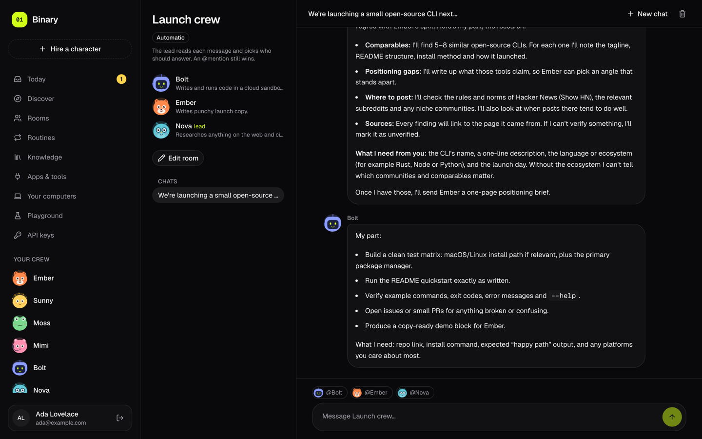
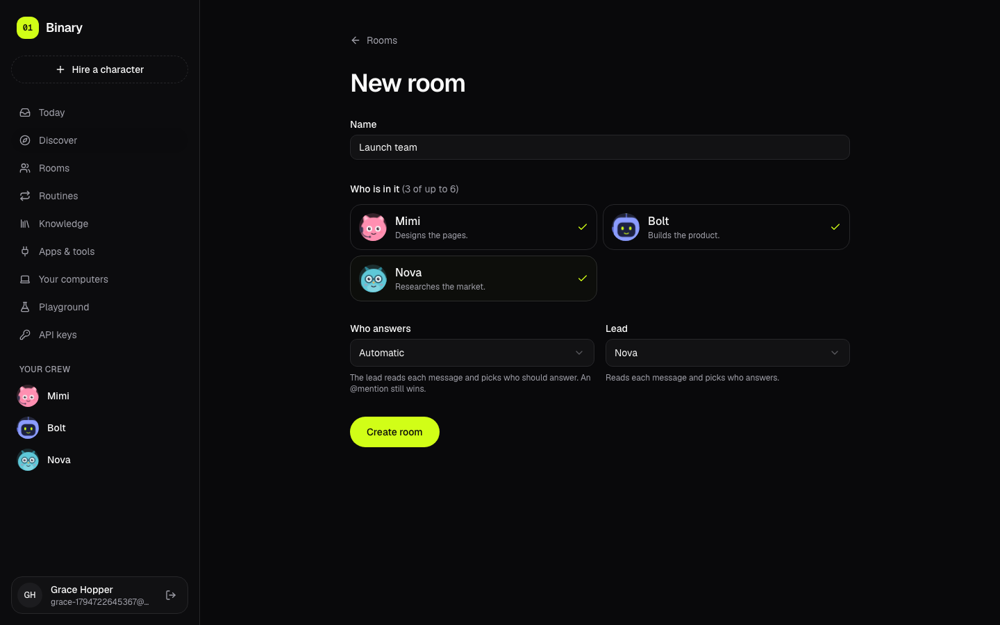
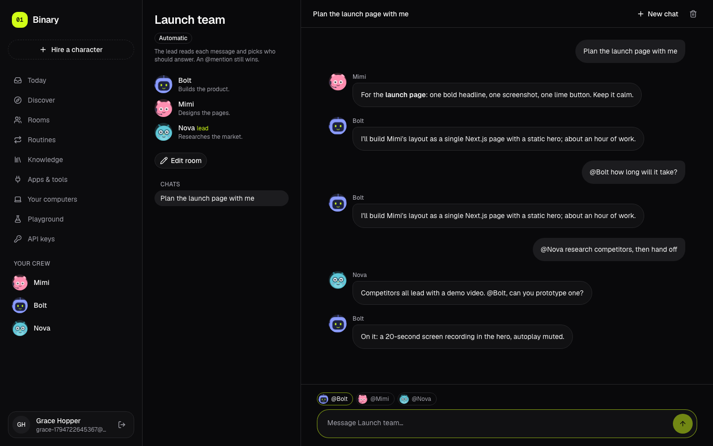

# Chapter 13: Multi-agent teams and rooms

Several characters work together in one chat. A **room** holds 2 to 6 of
your characters. Your message goes to the ones you @mention, or to the ones
the lead picks, and they answer in turn, building on each other and handing
work to a teammate when it fits.

## What you'll learn

- How **routing** decides who answers: by @mention, or by letting the
  lead's model choose
- Why characters answer **in turn** instead of all at once
- How a character sees the others' answers, labelled with their names, and
  still keeps its own voice
- How a **hand-off** works: an @mention inside an answer passes the turn
- Why a hard **cap** (4 answers per message) keeps a team from talking in
  circles

## Try it

There's no migration this time. With `pnpm dev` running:

1. Hire at least two characters.
2. Open **Rooms**, then **New room**. Pick the characters, how they answer
   (**@Mention** or **Automatic**) and a lead.
3. Send a message with no mention, then one with `@Name`. Use the @Name
   chips above the message box.
4. Ask one character to hand something over ("research it, then pass it to
   @Bolt") and watch the next one pick it up.

## Good to know

- An @mention always wins, even in Automatic mode.
- Each character still uses its own model, memory, tools and computer, so a
  room can mix Claude and GPT. Approvals from a room reach Today and lead
  back into the room.
- Deleting a room keeps its characters.

## Build it yourself

Paste [PROMPT.md](PROMPT.md) into your coding agent in your chapter 12 repo.
See [DIAGRAM.md](DIAGRAM.md) for one room message from start to end.

## Next

[Chapter 14](../chapter-14/README.md) brings your crew, rooms and Today to
the Expo mobile app, with voice input.
