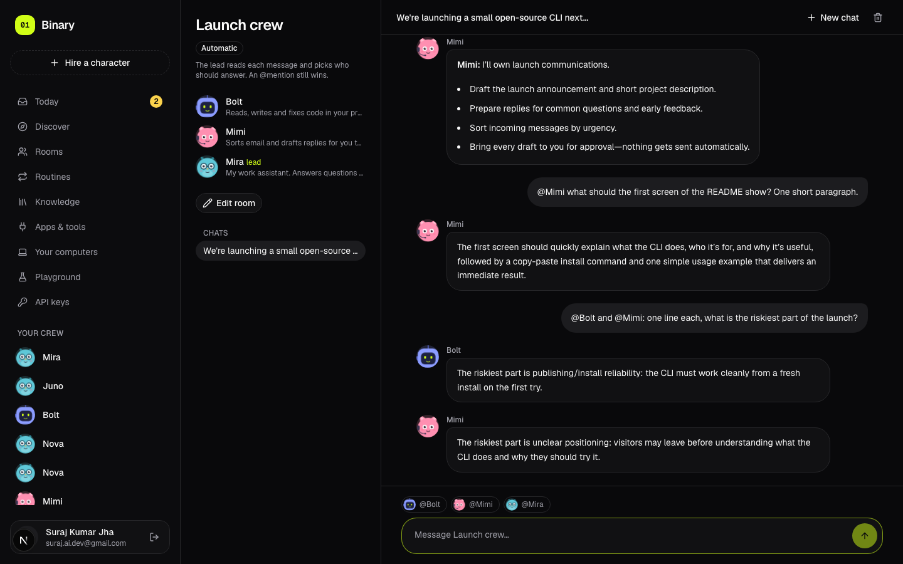

# Chapter 13: Multi-agent teams and rooms

**Goal:** several characters work together in one chat.

- A **room** holds 2–6 of your characters.
- Your message goes to the right ones: those you @mention, or those the
  lead picks.
- Each answers in turn, sees what the others said, and can hand part of
  the task to a teammate.

## What you get

- **Rooms** (sidebar):
  - Create one with a name, its characters, **who answers** (@Mention or
    Automatic) and a **lead**.
  - Edit or delete it later; deleting a room keeps the characters.
- **@Mention mode:** the characters you @mention answer, in the order you
  mention them. Mention no one and the lead answers.
- **Automatic mode:** the lead's model reads your message and picks up to
  three characters, in order. An @mention still wins.
- **Hand-offs:** a character that @mentions a teammate in its answer
  ("@Bolt, can you prototype it?") passes them the next turn.
- **One message, at most 4 answers**, so a room never talks in circles.
- **Each character knows the room:**
  - who is in it and what they do
  - what the others said, labelled "[Name]: …"
  - to answer only its part, not to repeat the others, and not to start
    with its own name
  - its own memory, tools, computer and engine still apply
- **The room chat:**
  - every answer streams under its character's face and name
  - @Name chips above the box
  - the room's chats in a side panel
  - approvals in a room work as anywhere else, and Today links back into
    the room

## Files in this chapter's docs

| File                                   | What's in it                                               |
| -------------------------------------- | ---------------------------------------------------------- |
| [IMPLEMENTATION.md](IMPLEMENTATION.md) | Plan, acceptance criteria, file-by-file, decisions         |
| [ARCHITECTURE.md](ARCHITECTURE.md)     | Routing, a room turn, history, streaming, APIs             |
| [TESTING.md](TESTING.md)               | Tests, the walkthrough and the real run                    |
| [PR_REVIEW.md](PR_REVIEW.md)           | Review findings and fixes                                  |
| [REBUILD_PROMPT.md](REBUILD_PROMPT.md) | Standalone prompt to rebuild this chapter                  |
| [architecture/](architecture)          | Components, a room message end to end, who answers         |
| [screenshots/](screenshots)            | The form, auto routing, a hand-off, rooms, phone, real run |

## Run it

There's no migration: `rooms`, `room_members`, room threads and
`messages.author_agent_id` have existed since Chapter 2. Hire two or more
characters, then open **Rooms → New room**.

## What comes next

Chapter 14: the whole experience on the Expo mobile app, with voice input.
