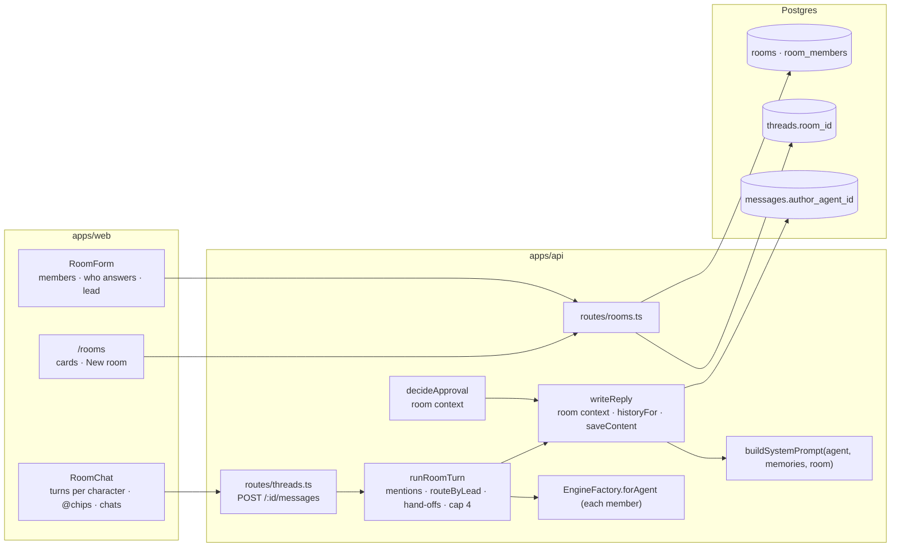

# System overview: Chapter 13

| Piece                   | Role                                                      |
| ----------------------- | --------------------------------------------------------- |
| `findMentions` (shared) | @Names in a text, in order, longest name first, once each |
| `routeByLead`           | The lead's model names who should answer (auto mode)      |
| `runRoomTurn`           | Save once; answer in turn; follow hand-offs; stream turns |
| `historyFor`            | Others' words as "[Name]: …" for each agent               |
| `RoomRepository`        | Rooms and members, owner-checked in transactions          |
