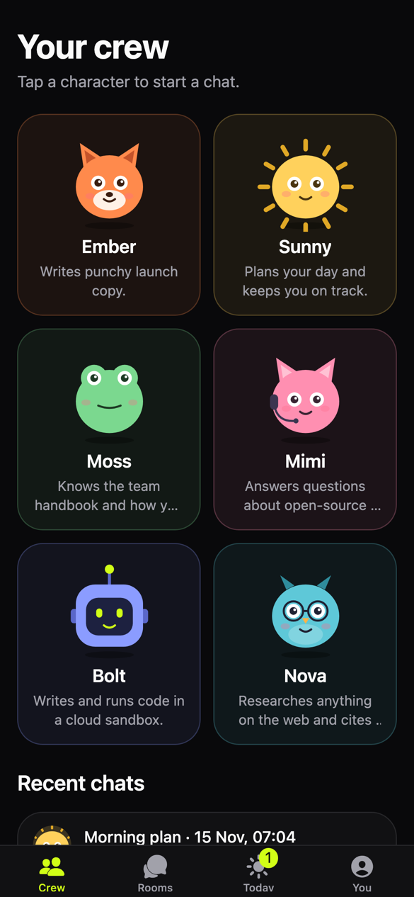
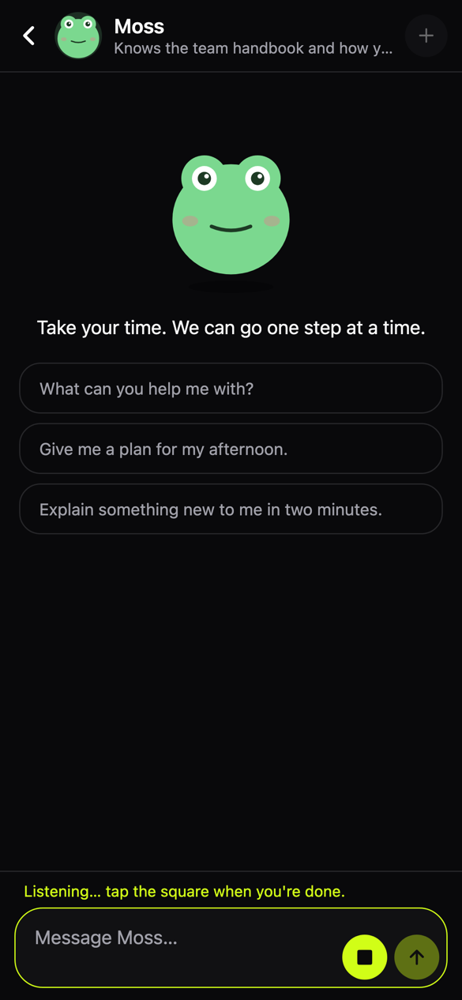

# Chapter 14: Mobile app and voice

The whole Binary experience comes to the Expo app: your crew, rooms and
Today inbox, with streaming chats and approvals. And you can talk instead of
typing: tap the mic, speak, and the words land in the message box.

| Crew                                               | Today                                                                  | Voice                                                         |
| -------------------------------------------------- | ---------------------------------------------------------------------- | ------------------------------------------------------------- |
|  |  |  |

## What you'll learn

- How a **mobile app shares one API** with the web, using the same session
  and the same streamed answers
- How **tabs and a sign-in guard** in Expo Router keep signed-out users on
  the sign-in screens
- How **voice input** works: record on the phone, transcribe on the server
- Why **API keys stay on the server**, even for a feature that starts on the
  phone
- How one drawing of the characters is **reused** by both apps

## Try it

There's no migration. Keep `pnpm dev` running, then:

```bash
cp apps/mobile/.env.example apps/mobile/.env   # set your laptop's IP
pnpm mobile                                    # scan the QR code with Expo Go
```

Sign in, open a character from **Crew** and send a message. Ask for
something that needs approval and decide it from **Today**. Then tap the
mic, say a sentence with a character's name in it, and stop. The text
lands in the box for you to check before sending.

## Good to know

- `EXPO_PUBLIC_API_URL` must be your laptop's Wi-Fi IP, not `localhost`,
  and the phone must be on the same Wi-Fi.
- **Voice needs an OpenAI key.** Anthropic and Google keys don't turn it on.
- Hiring characters, apps, API keys and routines stay on the web. Anything
  you change there shows up on the phone.

## Build it yourself

Paste [PROMPT.md](PROMPT.md) into your coding agent in your chapter 13 repo.
See [DIAGRAM.md](DIAGRAM.md) for how the phone, the API and your OpenAI key
fit together.

## Next

[Chapter 15](../chapter-15/README.md) makes Binary ready to share: a README
with every feature, real screenshots and a setup guide.
