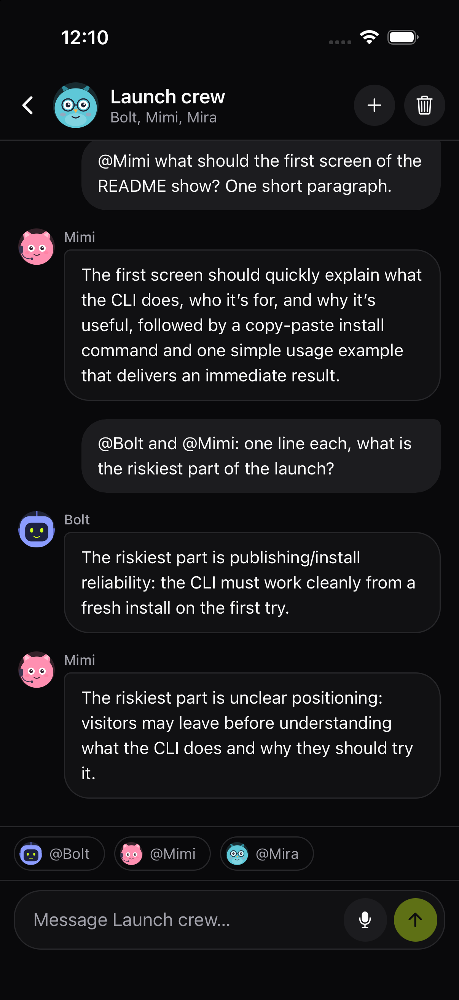
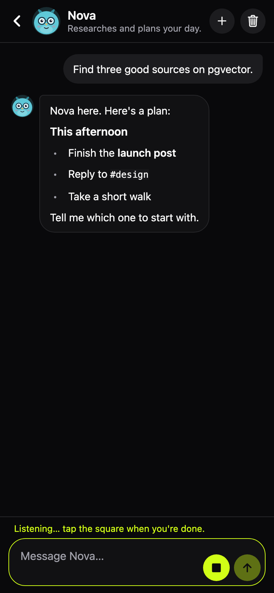

# Chapter 14: Mobile app and voice

**Goal:** the whole Binary experience in your pocket.

- Your crew, rooms and **Today** on the Expo app, with the same cartoon
  characters as the web.
- Answers stream in word by word, with tools, pictures and approvals.
- **Talk instead of typing:** tap the microphone, speak, and the words land
  in the message box.



## What you get

- **Four tabs:**
  - **Crew:** the characters you hired, and your recent chats.
  - **Rooms:** each room with its mode, faces and members.
  - **Today:** what waits for you (Approve, Reject, Open chat), and what
    your routines did. The tab shows a badge with the count.
  - **You:** your account, and Sign out.
- **Chats with one character:**
  - its face in the header reacts: thinking, talking (the mouth moves),
    happy, oops
  - a greeting and starters in an empty chat
  - answers stream in, with Markdown, tool rows you can open, charts and
    screenshots, and Approve / Reject on a tool that waits for you
  - New chat and Delete chat
- **Room chats:** every answer under its character's name; @Name chips
  above the box; the members, the lead, the mode and earlier chats in an
  empty room.
- **Voice input:**
  - tap the mic, speak, tap the square
  - the recording goes to the API, which turns it into text with **your
    OpenAI key**
  - the text lands in the box so you can fix a word before sending
  - your characters' names are passed as a hint, so "Bolt" isn't heard as
    "bold", and "at Mimi" becomes "@Mimi"
- **Approvals remember where you decided:** a decision from the phone is
  saved as `mobile` (the column has existed since Chapter 2).
- **The same characters, one drawing:** a script renders the web's
  `<Character>` to SVG for the app, so a change to a character reaches
  both apps.



## Files in this chapter's docs

| File                                   | What's in it                                               |
| -------------------------------------- | ---------------------------------------------------------- |
| [IMPLEMENTATION.md](IMPLEMENTATION.md) | Plan, acceptance criteria, file-by-file, decisions         |
| [ARCHITECTURE.md](ARCHITECTURE.md)     | Screens, the API client, streaming, voice, faces, APIs     |
| [TESTING.md](TESTING.md)               | Tests, the walkthrough, the simulator and the real voice   |
| [PR_REVIEW.md](PR_REVIEW.md)           | Review findings and fixes                                  |
| [REBUILD_PROMPT.md](REBUILD_PROMPT.md) | Standalone prompt to rebuild this chapter                  |
| [architecture/](architecture)          | Components, a spoken message end to end, the auth guard    |
| [screenshots/](screenshots)            | Crew, chats, voice, approvals, Today, rooms, iOS simulator |

## Run it

No migration. Start the API and web as usual (`pnpm dev`), then:

```bash
cp apps/mobile/.env.example apps/mobile/.env   # your laptop's IP, not localhost
pnpm mobile
```

Scan the QR code with Expo Go. Hire characters and add keys on the web;
they show up on the phone. Voice needs an OpenAI key (Settings on the web).

To try the app in a browser instead, run Expo with `--web`. The API only
accepts the browser origin in `WEB_URL`, so point a second API at it, e.g.
`WEB_URL=http://localhost:8081`.

## What comes next

Chapter 15: usage tracking, end-to-end tests and deployment.
