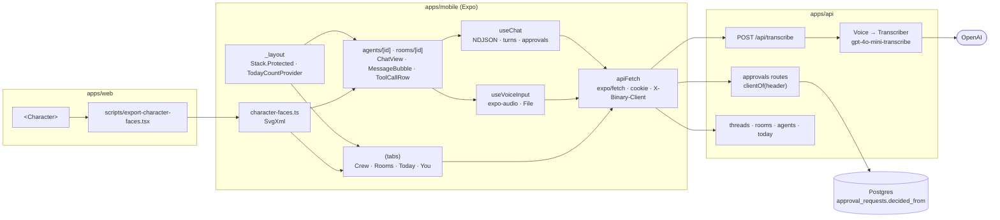

# System overview: Chapter 14

| Piece                    | Role                                                      |
| ------------------------ | --------------------------------------------------------- |
| `apiFetch`               | The one door to the API: cookie, client header, streaming |
| `useChat`                | One-to-one and room chats from the same events            |
| `useVoiceInput`          | Record, upload, put the words in the box                  |
| `Voice` / `Transcriber`  | The user's OpenAI key; names as a hint; a fake in tests   |
| `clientOf`               | `mobile` from the header, else `web`                      |
| `export-character-faces` | One drawing for both apps                                 |
