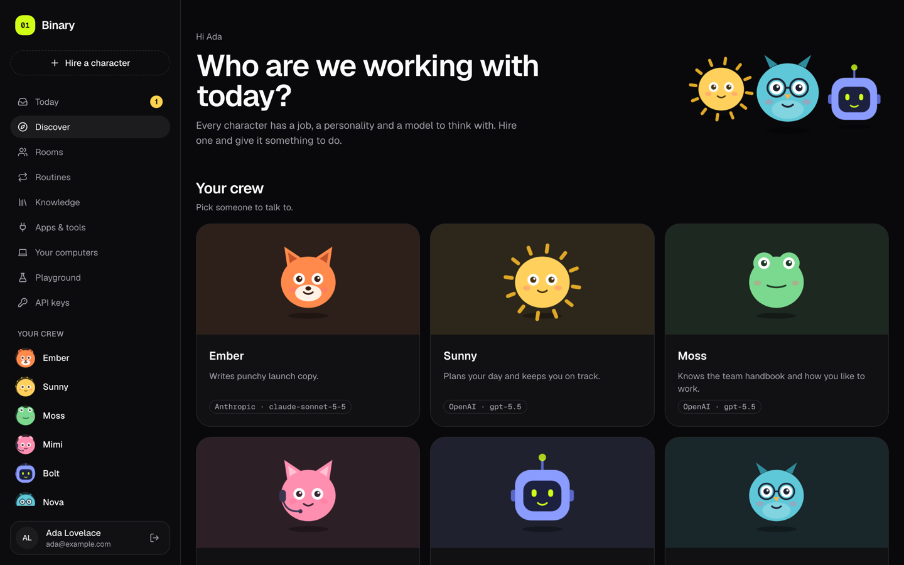

# Chapter 15: Ready to share

**Goal:** anyone can clone Binary, run it in minutes, and see what it does
before they start.

- A **README** that shows every feature with real screenshots.
- A **setup guide** from an empty machine to every optional feature: each
  `.env` line, where to get each key, and what to do when something goes
  wrong.
- **Proof it works:** the guide was followed on a fresh clone, and every
  link in the docs is checked.

Deployment is not part of this chapter: Binary is built to run on your own
computer.

## What you get

- **[README.md](../../../README.md)**, rewritten for a first visit:
  - what Binary is, in two sentences, and a link to the setup guide
  - every feature with real screenshots (27 of them): characters, chat
    with a browser and a sandbox, MCP apps, approvals and Today, the four
    computers, memory and knowledge, routines, rooms, the mobile app and
    voice, the playground and API keys
  - a 10-minute quick start, a system diagram, the stack, the project
    structure, the commands and the 15 chapters
- **[docs/SETUP.md](../../SETUP.md)**, the setup guide:
  - what to install, with a check for each
  - a quick start, then step by step: clone, `.env`, `pnpm setup` (and
    what it does), `pnpm dev`, the first key and character
  - every `.env` variable: needed or not, what it is, where to get it
  - AI providers: where to get each key and what each one unlocks
    (OpenAI for memory, knowledge and voice)
  - every optional feature: MCP apps (DeepWiki needs no account),
    Trigger.dev, E2B sandboxes and desktops, the browser, the Runner with
    Claude Code and Codex, memory and knowledge, the mobile app and voice
  - a "which feature needs what" table, 19 troubleshooting fixes, and how
    to start over
- **[The architecture overview](ARCHITECTURE.md):** the whole system on
  one page, for students who want the big picture before the chapters.
- **Fixes found while preparing it:**
  - `pnpm trigger:dev` couldn't build since Chapter 10 (Playwright can't be
    bundled). Playwright is now external in `trigger.config.ts`.
  - Tests ignored `DATABASE_URL` in `.env`, so with a changed port the
    migration and the tests used different databases. Tests now read it
    (and only it) from `.env`.
  - `pnpm install` showed a warning about `@depot/cli`'s install script,
    which local development never needs. It's now ignored on purpose.
  - Chapter 1's "Run it" link pointed at a README section that moved.

## The screenshots

They come from a showcase account, **Ada Lovelace**, with six characters
built around one story (launching a small open-source CLI), and **real**
answers: Claude Sonnet 5.5 and GPT-5.5, a real E2B sandbox, a real
browser, DeepWiki over MCP, and a routine run on Trigger.dev. They were
taken on the production web build at 1440×900 (2×, resized to 1440 wide),
and the mobile ones on the Expo web build at 390×844. They live in
[`docs/screenshots`](../../screenshots).

## Files in this chapter's docs

| File                                   | What's in it                                                |
| -------------------------------------- | ----------------------------------------------------------- |
| [IMPLEMENTATION.md](IMPLEMENTATION.md) | Plan, acceptance criteria, file-by-file, decisions          |
| [ARCHITECTURE.md](ARCHITECTURE.md)     | The whole system: apps, layers, flows, data, patterns       |
| [TESTING.md](TESTING.md)               | The fresh-clone run, the link check, the screenshot run     |
| [PR_REVIEW.md](PR_REVIEW.md)           | Review findings and fixes                                   |
| [REBUILD_PROMPT.md](REBUILD_PROMPT.md) | Standalone prompt to redo this chapter                      |
| [architecture/](architecture)          | The whole system, a message end to end, which key does what |

## Run it

Follow [the setup guide](../../SETUP.md).
